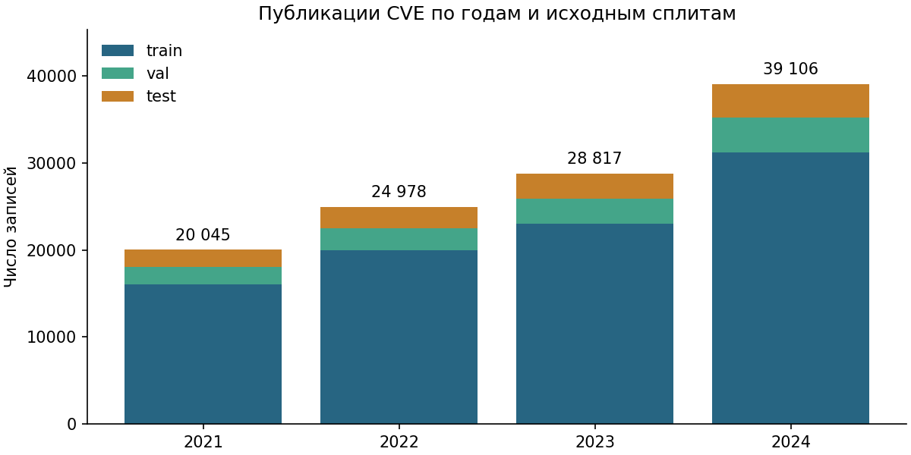
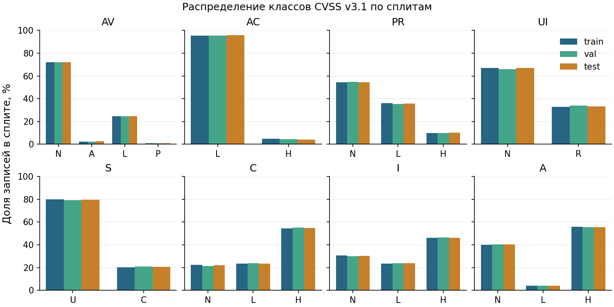
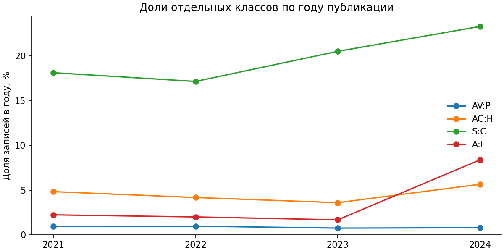
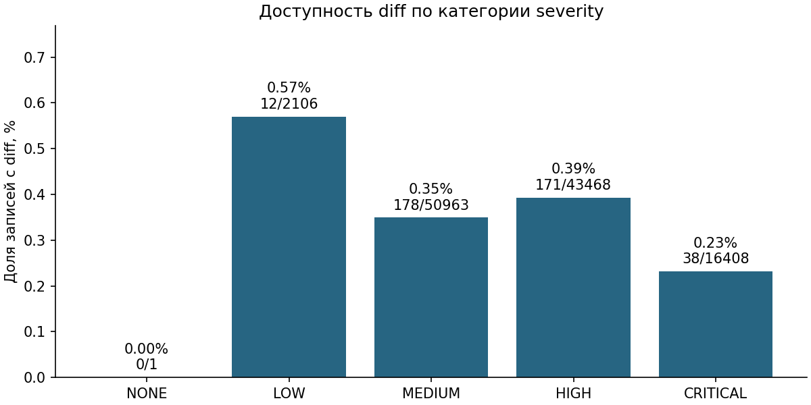

# EDA датасета CVSS v3.1

## Данные и воспроизведение

Одна строка соответствует одной CVE. Основной признак — английское `description`. Цели — восемь категориальных компонент `AV`, `AC`, `PR`, `UI`, `S`, `C`, `I`, `A` в `metrics`. Вектор, базовый балл и severity используются для проверки разметки и расчёта метрик. Дата публикации нужна для разбиения. CWE и diff — дополнительные поля сбора. Источник записей — [NIST NVD API 2.0](https://nvd.nist.gov/developers/vulnerabilities). Правила расчёта балла и severity описаны в [спецификации FIRST](https://www.first.org/cvss/v3-1/specification-document).

Всего проверено 112 946 строк. `dataset/val.jsonl` и `dataset/test.jsonl` доступны в Git, а `train.jsonl` взят из локального исторического снапшота проекта. Его удалось заново собрать из того же локального `nvd_cves.jsonl` и файлов `ref_patches.jsonl` и `osv_patches.jsonl` через `src/build_dataset.py`. Число строк и распределения всех восьми меток совпали с `dataset/meta.json` для каждого сплита. В [summary.json](summary.json) сохранены SHA-256 входов после нормализации переводов строк к LF, статистика и числители графиков.

Запуск из корня репозитория с Python и пакетами `numpy` и `matplotlib`:

```bash
python -m pip install numpy matplotlib
python -m src.eda_cvss --train /path/to/historical/train.jsonl --out-dir eda_full
```

В чистом клоне можно воспроизвести проверки на 22 595 доступных строках validation/test:

```bash
python -m src.eda_cvss --data-dir dataset --out-dir eda_public
```

Доступные данные можно дополнить собственной выгрузкой NVD за 2021–2024 годы и повторить сборку с `src/build_dataset.py`. NVD обновляет записи, поэтому новая выгрузка может отличаться от исторического снапшота.

## Состав и качество

| Проверка | Train | Validation | Test | Всего |
|---|---:|---:|---:|---:|
| Строки | 90 351 | 11 287 | 11 308 | 112 946 |
| Пустое описание | 0 | 0 | 0 | 0 |
| Некорректная дата или идентификатор CVE | 0 | 0 | 0 | 0 |
| Недопустимое или отсутствующее значение компоненты | 0 | 0 | 0 | 0 |
| Несовпадение меток с `vector_string` | 0 | 0 | 0 | 0 |
| Несовпадение `base_score` или `base_severity` с расчётом из компонент | 0 | 0 | 0 | 0 |
| Описания с упоминанием `CVSS` | 1 424 | 179 | 160 | 1 763 |
| Записи без CWE | 9 160 | 1 128 | 1 124 | 11 412 |
| Записи с непустым diff | 320 | 42 | 37 | 399 |
| Длина текста, медиана / 95-й перцентиль, слова | 37 / 116 | 38 / 116 | 37 / 111 | — |

Валидация балла проверяет внутреннюю согласованность полей с реализацией `cvss31_score` проекта. Содержательная оценка меток требует эксперта. Упоминание `CVSS` — индикатор для проверки утечки. Часть таких упоминаний может содержать готовую оценку. Для обучения и оценки нужно одинаково маскировать явные значения CVSS, проверить выборку текстов вручную и публиковать качество на срезе с маскированием. Длины посчитаны в словах и служат ориентиром для отдельной проверки длины в токенах DistilBERT.

### Временное покрытие



В каждом сплите есть публикации с 1 января 2021 по 31 декабря 2024 года. В 2024 году в снапшоте 39 106 строк, почти вдвое больше, чем в 2021 году (20 045). Текущая оценка относится к стратифицированному случайному сплиту. Для оценки на будущих CVE нужен отдельный хронологический тест с проверкой групп описаний.

### Дисбаланс и изменение долей классов



В train `AC:L` составляет 95,29% (86 093 из 90 351), тогда как `AV:P` встречается в 0,85% строк (770 из 90 351) и лишь в 99 строках test. Сходство долей в случайных сплитах полезно для исторического сравнения. Для оценки редких классов нужны macro-F1, полнота и число примеров по каждому классу.



Доля `A:L` выросла с 1,68% в 2023 году до 8,38% в 2024-м, а `S:C` — с 17,14% в 2022-м до 23,29% в 2024-м. Причина по агрегатам неизвестна. В хронологической оценке эти срезы следует проверять отдельно.

### Повторы и расхождения разметки

Среди всех сплитов нет повторяющихся `cve_id`. Для проверки повторов текста описания приведены к регистронезависимой форме, ведущие и хвостовые пробелы удалены, последовательности пробельных символов заменены одним пробелом. Похожие тексты, различающиеся версиями или пунктуацией, эта проверка может пропустить.

| Пара | Общих групп описаний | Строк первого сплита с общим текстом | Строк второго сплита с общим текстом |
|---|---:|---:|---:|
| train / val | 639 | 3 468 | 902 |
| train / test | 601 | 3 244 | 854 |
| val / test | 209 | 414 | 410 |

В 770 из 2 362 групп повторяющихся текстов есть разные CVSS-векторы. Эти группы содержат 4 014 строк. Около 7,55% исходного теста имеют совпадающий текст в train. На новом разбиении нужно держать группы в одной части, отдельно отчитываться о результатах на знакомых шаблонах и проверять конфликтующие группы с аналитиком. Одинаковый текст может скрывать различия в затронутом контексте, поэтому автоматическое голосование за наиболее частую метку может исказить целевую разметку.

### Доступность дополнительных признаков



Diff присутствует у 399 записей (0,35%), включая 37 из test. Его доступность различается по severity, например 38 из 16 408 для `CRITICAL` и 12 из 2 106 для `LOW`. Оценка модели на этом подмножестве подвержена отбору. Основной MVP использует описание, доступное при первичной оценке. CWE остаётся диагностическим полем с пропусками у 10,10% записей.

Решения о временном разбиении, проверке утечки, объёме экспертной разметки и выборе модели описаны в [дизайн-документе](../ml_system_design_doc.md#23-этапы-решения-задачи).
