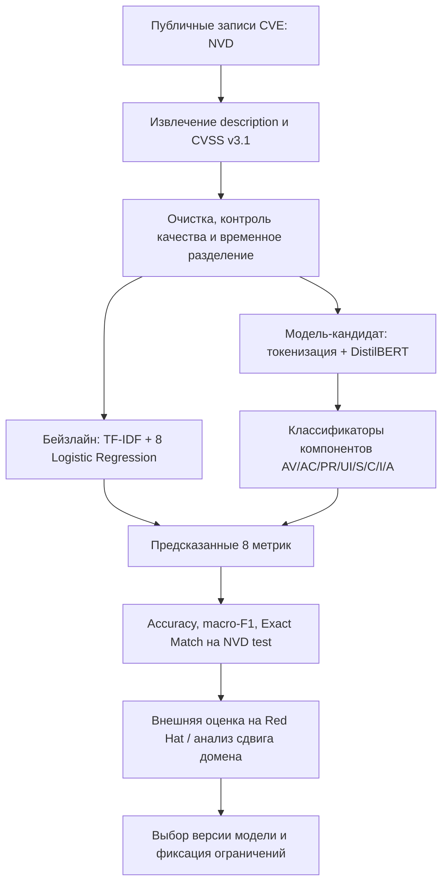
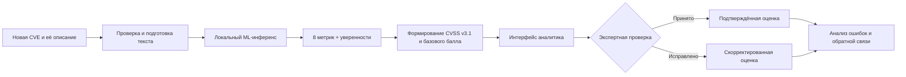

# Дизайн ML-системы: автоматическое определение вектора CVSS v3.1 по описанию уязвимости

**Тип системы:** сервис поддержки аналитиков информационной безопасности (MVP / пилот).  
**Итерация:** подготовка и оценка ML-компонента, интеграция в рабочий процесс аналитика.  
**Статус документа:** проект для ДЗ № 1 MLSD; продуктовые критерии пилота требуют согласования с заказчиком.

Документ подготовлен по структуре [ML System Design Doc от Reliable ML](https://github.com/IrinaGoloshchapova/ml_system_design_doc_ru/blob/main/ML_System_Design_Doc_Template.md). Открытый [репозиторий CWE_CVSS](https://github.com/ann04ka/CWE_CVSS) содержит исследовательскую часть решения; описание внутреннего пилота ниже отражает целевой сценарий, а не утверждение о наличии всех компонентов в данном репозитории.

## 1. Цели и предпосылки

### 1.1. Зачем идём в разработку продукта?

**Проблема.** Поток публикуемых CVE создаёт значительную нагрузку на аналитиков информационной безопасности. Для первичной оценки уязвимости специалист изучает её текстовое описание и определяет восемь базовых метрик CVSS v3.1. Ручная процедура требует времени, а доступные оценки из внешних источников могут отсутствовать или расходиться с принятой в организации практикой разметки.

**Бизнес-цель.** Сократить трудозатраты на первичную оценку уязвимостей за счёт автоматической подготовки предварительного вектора CVSS v3.1, сохранив за аналитиком окончательное решение.

**Продукт.** Аналитик получает для CVE предварительно предсказанные значения AV, AC, PR, UI, S, C, I и A и оценки уверенности модели. Аналитик проверяет результат, при необходимости корректирует его и использует в дальнейшем процессе обработки уязвимости.

**Почему применяем ML.** Признаки, необходимые для определения метрик CVSS, частично содержатся в естественно-языковом описании уязвимости. NLP-классификатор может выявлять такие признаки на основании размеченных исторических CVE. При этом модель не заменяет анализ контекста эксплуатации: описание может не содержать всех необходимых сведений.

**Успех итерации.** Наличие воспроизводимого ML-бейзлайна и модели-кандидата, измеренного качества на отложенных и внешних данных, доступного интерфейса получения рекомендаций и процедуры экспертной проверки. Численные пороги бизнес-успеха должны быть согласованы с пользователями по результатам пилота; их нельзя считать уже достигнутыми.

### 1.2. Бизнес-требования и ограничения

| Категория | Требование / ограничение | Проверка |
|---|---|---|
| Функциональность | Получать восемь метрик базового вектора CVSS v3.1 по тексту описания CVE | Проверка ответа сервиса на тестовых примерах |
| Поддержка решения | Показывать уверенность по предсказаниям и давать аналитику возможность пересмотреть результат | Пользовательское тестирование пилота |
| Качество | Измерять качество каждой метрики отдельно и долю полностью совпавших векторов | Accuracy, macro-F1, Exact Match на независимых тестовых выборках |
| Надёжность | Не считать автоматический ответ окончательной экспертной оценкой | Экспертная проверка и возможность корректировки |
| Работа с данными | Не передавать внутренние описания уязвимостей во внешние сервисы без разрешения организации | Проверка архитектуры и маршрутов обработки данных |
| Эксплуатация | Предусмотреть инференс на доступной инфраструктуре, в том числе CPU | Замеры задержки и ресурсов на целевом окружении |
| Масштабирование | Оценить возможность пакетной обработки входящего потока CVE | Нагрузочный тест; целевая производительность согласовывается отдельно |
| Прослеживаемость | Сохранять версию модели, предсказанный вектор и результат экспертной проверки там, где это разрешено политиками доступа | Аудит тестовых записей |

**Пилотный бизнес-процесс.** CVE поступает в систему обработки уязвимостей → описание передаётся локальному ML-компоненту → аналитик получает предлагаемый вектор и уверенности → сверяет с доступными источниками и контекстом → принимает или редактирует результат. Факт принятия решения и выявленные расхождения могут быть использованы для последующего анализа ошибок с соблюдением правил доступа к данным.

**Ограничения и неопределённости.** Описания из разных источников различаются по полноте и стилю; разные организации могут присваивать отличающиеся векторы одной CVE. Поэтому хорошая оценка на NVD сама по себе не гарантирует требуемого качества на внутренних данных. Численные целевые значения задержки, пропускной способности и качества для промышленной эксплуатации требуют отдельного утверждения.

### 1.3. Что входит в скоуп проекта / итерации, что не входит

**Входит:**

- подготовка открытых размеченных CVE и проверка качества разметки;
- построение и сравнение простого бейзлайна (TF-IDF + Logistic Regression) и моделей на базе трансформеров;
- предсказание восьми компонентов CVSS v3.1 из текста описания уязвимости;
- расчёт вектора CVSS и, при необходимости, базового балла по стандартной формуле;
- оценка по каждому компоненту, Exact Match всего вектора и анализ ошибок;
- проверка переносимости модели между источниками описаний и разметки;
- подготовка компонента инференса с интерфейсом выдачи предсказаний и уверенностей для пилота.

**Не входит:**

- автоматическое принятие финального решения об уровне риска без участия аналитика;
- оценка конкретного риска для инфраструктуры компании с учётом всех компенсирующих мер и контекста активов;
- гарантированное восстановление полной информации об уязвимости из неполного описания;
- обучение и оценка модели определения CWE в рамках *этой* итерации документа: CWE — связанное направление более широкого продукта, но основной объект исследования здесь — CVSS v3.1;
- промышленная гарантия SLA и безусловная обработка любого объёма CVE без нагрузочных испытаний.

**Критерии готовности инженерного результата.** Зафиксированы источники и схема данных, конфигурации моделей, разбиение train/validation/test, способ расчёта метрик и процедура воспроизводимой проверки. Программный интерфейс возвращает структурированный результат с компонентами вектора и, где поддерживается моделью, уверенностями.

**Планируемый технический долг:** централизованное версионирование данных и моделей, мониторинг дрейфа данных и разметки, автоматизированный регрессионный набор, сбор экспертной обратной связи и расширение объяснений для аналитика.

### 1.4. Предпосылки решения

1. **Объект предсказания** — одна CVE с текстовым описанием на английском языке; информация об одной CVE не должна попадать одновременно в обучение и независимую оценку.
2. **Источник для разработки** — NIST NVD; в открытом репозитории описана выборка из **112 946 CVE за 2021–2024 годы** с временным разбиением: train **90 351**, validation **11 287**, test **11 308**.
3. **Целевая разметка** — восемь базовых компонентов CVSS v3.1. Балл severity рассчитывается из вектора, а не предсказывается как самостоятельная независимая цель в рамках этой постановки.
4. **Внешняя проверка** — сравнение на данных другого источника (в исследовании используется Red Hat) необходимо для оценки обобщающей способности; при расхождении текстов и экспертной разметки их влияние следует рассматривать отдельно.
5. **Частота обработки** определяется появлением новых или изменённых CVE; оперативная переоценка возможна при поступлении уточнённого описания. Периодичность переобучения устанавливается по результатам мониторинга, а не заранее.
6. **Инфраструктурная предпосылка** — внутри организации предпочтителен локально развернутый инференс без отправки чувствительных данных внешнему API.

## 2. Методология

### 2.1. Постановка задачи

На вход подаётся строка `description` — описание уязвимости CVE. Требуется предсказать категориальные значения восьми метрик CVSS v3.1.

| Метрика | Смысл | Допустимые значения |
|---|---|---|
| AV | Attack Vector | N, A, L, P |
| AC | Attack Complexity | L, H |
| PR | Privileges Required | N, L, H |
| UI | User Interaction | N, R |
| S | Scope | U, C |
| C | Confidentiality Impact | N, L, H |
| I | Integrity Impact | N, L, H |
| A | Availability Impact | N, L, H |

Это восемь связанных задач классификации. Выход — вектор формата `CVSS:3.1/AV:.../AC:.../PR:.../UI:.../S:.../C:.../I:.../A:...`, значения компонентов и оценки уверенности (если соответствующая архитектура позволяет их получить). Уверенность модели не следует автоматически трактовать как калиброванную вероятность правильного ответа без отдельной проверки калибровки.

**Метрики оценки:** accuracy и macro-F1 по каждой компоненте; Exact Match по всем восьми компонентам одновременно. Дополнительно полезны матрицы ошибок, ошибка по редким классам и анализ критических промахов. Для переносимости между источниками те же метрики рассчитываются отдельно на каждой выборке и для согласованных / расходящихся разметок.

**Известный ориентир исследования:** в README открытого репозитория приведены **89,6% средней accuracy** и **52,9% Exact Match** для лучшей исследованной архитектуры B2 на тесте NVD. Это **не** означает, что такие же значения получены на внутренних данных или что они соответствуют порогу принятия в промышленную эксплуатацию.

### 2.2. Блок-схемы решения

**Исследовательский процесс: данные → обучение → проверка.**

**Сценарий пилотного применения: рекомендация аналитику.**

Обе схемы отражают задачи данного продукта: первую можно сопоставить с экспериментами открытого репозитория, вторая описывает целевой рабочий процесс пилота. Схемы не подразумевают, что весь пилотный интерфейс или хранилище обратной связи находятся в публичном репозитории.

### 2.3. Этапы решения задачи

**Этап 1 — сбор и подготовка данных.** Из NVD извлекаются идентификаторы CVE, описания и CVSS v3.1. Для обучения используются записи с корректным текстом и полным вектором. Проверяются пропуски, повторные версии одной CVE, распределения классов и дат. Временное разбиение уменьшает риск переоценки качества на более ранних записях. Выход этапа — воспроизводимые выборки и отчёт EDA.

**Этап 2 — бейзлайн.** Тексты преобразуются с помощью TF-IDF, для восьми метрик обучаются независимые классификаторы Logistic Regression. Бейзлайн нужен как измеримая и относительно дешёвая точка сравнения. Выход — прогнозы на общем тестовом наборе и метрики качества.

**Этап 3 — модель-кандидат.** Описания токенизируются; проверяются архитектуры с DistilBERT, в том числе отдельные классификаторы и вариант с общим энкодером и несколькими выходными головами. Цель — оценить, оправдывает ли выигрыш по качеству увеличение требований к памяти и времени инференса. В исследовательском контуре также рассматривалось объединение текстового и кодового представления для записей с доступным патчем, но это не обязательный вход основного текстового пилота.

**Этап 4 — независимая оценка и анализ ошибок.** Помимо стандартного NVD-теста проводится внешняя проверка на Red Hat, поскольку описания и принципы назначения CVSS могут отличаться. При наличии двух текстов и двух векторов для одной CVE важно отдельно исследовать эффект смены текста и эффект различий разметки. Выход — отчёт о качестве на доменах и перечень известных ограничений.

**Этап 5 — подготовка пилота.** Модель загружается один раз при старте сервиса; запрос содержит текст описания, ответ — восемь значений и уверенности. Выполняются функциональные тесты, измерения задержки на целевой инфраструктуре и ручная проверка примеров аналитиками. Финальное решение остаётся за экспертом.

## 3. Подготовка пилота

### 3.1. Способ оценки пилота

Для согласованной выборки входящих CVE сравниваются предсказания модели с экспертными решениями аналитиков. Фиксируются расхождения по каждой метрике, доля полностью совпавших векторов, случаи критичных ошибок и время, затрачиваемое аналитиком на обработку. Для корректной оценки эффекта ускорения требуется сопоставимый контрольный процесс без подсказок модели.

### 3.2. Что считаем успешным пилотом

Пилот следует считать успешным только при одновременном выполнении согласованных с заказчиком условий: приемлемое экспертами качество, отсутствие неприемлемых критичных ошибок, измеримое сокращение времени обработки и стабильная работа в целевой среде. **Численные пороги и SLA пока не зафиксированы в этом документе**: они подлежат согласованию до формального приёмочного тестирования.

### 3.3. Подготовка пилота и риски

| Риск | Последствие | Способ снижения |
|---|---|---|
| Сдвиг распределения текстов NVD → внутренние описания | Падение качества модели | Внешняя проверка и мониторинг качества по источникам |
| Несовпадение политик присвоения CVSS | «Ошибки» относительно выбранной эталонной разметки | Явно фиксировать источник целевой разметки и правила согласования |
| Недостаточно информации в тексте CVE | Неопределённые или ошибочные компоненты | Показ уверенностей и обязательная экспертная проверка |
| Дисбаланс классов | Слабое качество для редких значений | Macro-F1, отдельный анализ редких классов |
| Ограниченные CPU-ресурсы | Рост времени ответа и очередей | Профилирование, повторное использование загруженной модели, пакетный режим при необходимости |
| Появление новых типов описаний | Деградация со временем | Версионирование выборок и регулярная повторная оценка |

## 4. Внедрение (контур пилота)

**Архитектура.** Компонент инференса работает внутри контролируемой инфраструктуры. Сервис принимает описание CVE, запускает предобработку и модель, валидирует допустимые значения компонентов, формирует структурированный ответ и передаёт его в интерфейс аналитика. Предпочтительна загрузка весов и токенизатора один раз при старте процесса, а не на каждый запрос.

**Нефункциональные требования, подлежащие проверке:** устойчивость к пустым или некорректным описаниям; воспроизводимость версии модели; проверка задержки на CPU; исключение передачи чувствительных описаний во внешние системы; контроль логирования и разграничения прав на экспертные исправления. Конкретные значения нагрузки, SLA, расходов и задержки определяются по результатам замеров, а не декларируются без испытаний.

## 5. Источники и материалы

1. [CWE_CVSS — открытый исследовательский репозиторий](https://github.com/ann04ka/CWE_CVSS).
2. [Reliable ML — ML System Design Doc (RU), шаблон](https://github.com/IrinaGoloshchapova/ml_system_design_doc_ru/blob/main/ML_System_Design_Doc_Template.md).
3. [FIRST — CVSS v3.1 Specification Document](https://www.first.org/cvss/v3.1/specification-document).
4. [NIST NVD API](https://nvd.nist.gov/developers/vulnerabilities).
