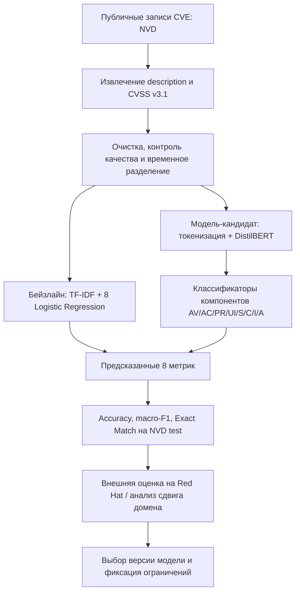
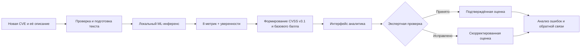

# Дизайн ML-системы: автоматическое определение вектора CVSS v3.1 по описанию уязвимости

**Тип системы:** сервис поддержки аналитиков информационной безопасности (MVP / пилот).  
**Итерация:** подготовка и оценка ML-компонента, интеграция в рабочий процесс аналитика.  
**Статус документа:** ДЗ № 2 MLSD. Этапы уточнены по результатам EDA. Продуктовые критерии пилота требуют согласования с заказчиком.

Документ подготовлен по структуре [ML System Design Doc от Reliable ML](https://github.com/IrinaGoloshchapova/ml_system_design_doc_ru/blob/main/ML_System_Design_Doc_Template.md). Открытый [репозиторий CWE_CVSS](https://github.com/ann04ka/CWE_CVSS) содержит исследовательскую часть решения; описание внутреннего пилота ниже отражает целевой сценарий, а не утверждение о наличии всех компонентов в данном репозитории.

## 1. Цели и предпосылки

### 1.1. Зачем идём в разработку продукта?

**Проблема.** Поток публикуемых CVE создаёт значительную нагрузку на аналитиков информационной безопасности. Для первичной оценки уязвимости специалист изучает её текстовое описание и определяет восемь базовых метрик CVSS v3.1. Ручная процедура требует времени, а доступные оценки из внешних источников могут отсутствовать или расходиться с принятой в организации практикой разметки.

**Бизнес-цель.** Сократить трудозатраты на первичную оценку уязвимостей за счёт автоматической подготовки предварительного вектора CVSS v3.1, сохранив за аналитиком окончательное решение.

**Продукт.** Аналитик получает для CVE предварительно предсказанные значения AV, AC, PR, UI, S, C, I и A и оценки уверенности модели. Аналитик проверяет результат, при необходимости корректирует его и использует в дальнейшем процессе обработки уязвимости.

**Почему применяем ML.** Признаки, необходимые для определения метрик CVSS, частично содержатся в естественно-языковом описании уязвимости. NLP-классификатор может выявлять такие признаки на основании размеченных исторических CVE. При этом модель не заменяет анализ контекста эксплуатации: описание может не содержать всех необходимых сведений.

**Успех итерации.** Наличие воспроизводимого ML-бейзлайна и модели-кандидата, измеренного качества на отложенных и внешних данных, доступного интерфейса получения рекомендаций и процедуры экспертной проверки. Численные пороги бизнес-успеха должны быть согласованы с пользователями по результатам пилота; их нельзя считать уже достигнутыми.

### 1.2. Бизнес-требования и ограничения

| Категория | Требование / ограничение | Проверка |
|---|---|---|
| Функциональность | Получать восемь метрик базового вектора CVSS v3.1 по тексту описания CVE | Проверка ответа сервиса на тестовых примерах |
| Поддержка решения | Показывать уверенность по предсказаниям и давать аналитику возможность пересмотреть результат | Пользовательское тестирование пилота |
| Качество | Измерять качество каждой метрики отдельно и долю полностью совпавших векторов | Accuracy, macro-F1, Exact Match на независимых тестовых выборках |
| Надёжность | Не считать автоматический ответ окончательной экспертной оценкой | Экспертная проверка и возможность корректировки |
| Работа с данными | Не передавать внутренние описания уязвимостей во внешние сервисы без разрешения организации | Проверка архитектуры и маршрутов обработки данных |
| Эксплуатация | Предусмотреть инференс на доступной инфраструктуре, в том числе CPU | Замеры задержки и ресурсов на целевом окружении |
| Масштабирование | Оценить возможность пакетной обработки входящего потока CVE | Нагрузочный тест; целевая производительность согласовывается отдельно |
| Прослеживаемость | Сохранять версию модели, предсказанный вектор и результат экспертной проверки там, где это разрешено политиками доступа | Аудит тестовых записей |

**Пилотный бизнес-процесс.** CVE поступает в систему обработки уязвимостей → описание передаётся локальному ML-компоненту → аналитик получает предлагаемый вектор и уверенности → сверяет с доступными источниками и контекстом → принимает или редактирует результат. Факт принятия решения и выявленные расхождения могут быть использованы для последующего анализа ошибок с соблюдением правил доступа к данным.

**Ограничения и неопределённости.** Описания из разных источников различаются по полноте и стилю; разные организации могут присваивать отличающиеся векторы одной CVE. Поэтому хорошая оценка на NVD сама по себе не гарантирует требуемого качества на внутренних данных. Численные целевые значения задержки, пропускной способности и качества для промышленной эксплуатации требуют отдельного утверждения.

### 1.3. Что входит в скоуп проекта / итерации, что не входит

**Входит:**

- подготовка открытых размеченных CVE и проверка качества разметки;
- построение и сравнение простого бейзлайна (TF-IDF + Logistic Regression) и моделей на базе трансформеров;
- предсказание восьми компонентов CVSS v3.1 из текста описания уязвимости;
- расчёт вектора CVSS и, при необходимости, базового балла по стандартной формуле;
- оценка по каждому компоненту, Exact Match всего вектора и анализ ошибок;
- проверка переносимости модели между источниками описаний и разметки;
- подготовка компонента инференса с интерфейсом выдачи предсказаний и уверенностей для пилота.

**Не входит:**

- автоматическое принятие финального решения об уровне риска без участия аналитика;
- оценка конкретного риска для инфраструктуры компании с учётом всех компенсирующих мер и контекста активов;
- гарантированное восстановление полной информации об уязвимости из неполного описания;
- обучение и оценка модели определения CWE в рамках *этой* итерации документа: CWE — связанное направление более широкого продукта, но основной объект исследования здесь — CVSS v3.1;
- промышленная гарантия SLA и безусловная обработка любого объёма CVE без нагрузочных испытаний.

**Критерии готовности инженерного результата.** Зафиксированы источники и схема данных, конфигурации моделей, разбиение train/validation/test, способ расчёта метрик и процедура воспроизводимой проверки. Программный интерфейс возвращает структурированный результат с компонентами вектора и, где поддерживается моделью, уверенностями.

**Планируемый технический долг:** централизованное версионирование данных и моделей, мониторинг дрейфа данных и разметки, автоматизированный регрессионный набор, сбор экспертной обратной связи и расширение объяснений для аналитика.

### 1.4. Предпосылки решения

1. **Объект предсказания** — одна CVE с текстовым описанием на английском языке; информация об одной CVE не должна попадать одновременно в обучение и независимую оценку.
2. **Источник для разработки** — NIST NVD. Историческая выборка из **112 946 CVE за 2021–2024 годы** разбита случайно со стратификацией по `AV × severity`. В train **90 351** записей, в validation **11 287**, в test **11 308**. Для оценки MVP на будущих CVE запланировано хронологическое разбиение.
3. **Целевая разметка** — восемь базовых компонентов CVSS v3.1. Балл severity рассчитывается из вектора, а не предсказывается как самостоятельная независимая цель в рамках этой постановки.
4. **Внешняя проверка** — сравнение на данных другого источника (в исследовании используется Red Hat) необходимо для оценки обобщающей способности; при расхождении текстов и экспертной разметки их влияние следует рассматривать отдельно.
5. **Частота обработки** определяется появлением новых или изменённых CVE; оперативная переоценка возможна при поступлении уточнённого описания. Периодичность переобучения устанавливается по результатам мониторинга, а не заранее.
6. **Инфраструктурная предпосылка** — внутри организации предпочтителен локально развернутый инференс без отправки чувствительных данных внешнему API.

## 2. Методология

### 2.1. Постановка задачи

На вход подаётся строка `description` — описание уязвимости CVE. Требуется предсказать категориальные значения восьми метрик CVSS v3.1.

| Метрика | Смысл | Допустимые значения |
|---|---|---|
| AV | Attack Vector | N, A, L, P |
| AC | Attack Complexity | L, H |
| PR | Privileges Required | N, L, H |
| UI | User Interaction | N, R |
| S | Scope | U, C |
| C | Confidentiality Impact | N, L, H |
| I | Integrity Impact | N, L, H |
| A | Availability Impact | N, L, H |

Это восемь связанных задач классификации. Выход — вектор формата `CVSS:3.1/AV:.../AC:.../PR:.../UI:.../S:.../C:.../I:.../A:...`, значения компонентов и оценки уверенности (если соответствующая архитектура позволяет их получить). Уверенность модели не следует автоматически трактовать как калиброванную вероятность правильного ответа без отдельной проверки калибровки.

**Метрики оценки:** accuracy и macro-F1 по каждой компоненте; Exact Match по всем восьми компонентам одновременно. Дополнительно полезны матрицы ошибок, ошибка по редким классам и анализ критических промахов. Для переносимости между источниками те же метрики рассчитываются отдельно на каждой выборке и для согласованных / расходящихся разметок.

**Известный ориентир исследования:** в README открытого репозитория приведены **89,6% средней accuracy** и **52,9% Exact Match** для лучшей исследованной архитектуры B2 на тесте NVD. Это **не** означает, что такие же значения получены на внутренних данных или что они соответствуют порогу принятия в промышленную эксплуатацию.

### 2.2. Блок-схемы решения

**Исследовательский процесс: данные → обучение → проверка.**

**Сценарий пилотного применения: рекомендация аналитику.**

Обе схемы отражают задачи данного продукта: первую можно сопоставить с экспериментами открытого репозитория, вторая описывает целевой рабочий процесс пилота. Схемы не подразумевают, что весь пилотный интерфейс или хранилище обратной связи находятся в публичном репозитории.

### 2.3. Этапы решения задачи

#### Этап 1. Подготовка данных

Одна строка описывает одну CVE. Ключ для объединения и версионирования — `cve_id`. У бейзлайна и MVP общий основной признак, английское описание из записи CVE.

| Признаки и служебные поля | Доступность и источник | Кто готовит | Проверка качества |
|---|---|---|---|
| `description` | Публичная англоязычная версия из NVD | DE / DS | Пустых строк 0. Найдено 1 763 упоминания CVSS для проверки утечки |
| `cve_id`, `published` | NVD. Ключ объединения и временного разбиения | DE | 112 946 уникальных корректных ID, все даты валидны |
| `cwes`, `patch_diff` | CWE поступают из NVD. Публичные diff собраны отдельно | DE / DS | У 11 412 строк нет CWE, diff есть у 399 строк. Поля используются для диагностики покрытия |

| Цели и производные поля | Доступность и источник | Кто готовит | Проверка качества |
|---|---|---|---|
| `AV`, `AC`, `PR`, `UI`, `S`, `C`, `I`, `A` | `metrics` извлекается из CVSS v3.1 в NVD | DE / DS | Все значения допустимы и совпадают с полями `vector_string` |
| `base_score`, `base_severity` | NVD. Балл проверяется пересчётом по восьми компонентам и используется для метрик | DS | Расхождений с пересчитанными значениями 0 |
| Внешний эталон и исправления эксперта | Red Hat для внешней оценки, внутренние аналитики для пилота | DS / аналитик ИБ | Проверить версию CVSS, принадлежность к источнику и расхождения оценок на парных CVE |

**Формирование снапшота.** `src/collect_nvd.py` запрашивает NVD API 2.0 по окнам публикации с пагинацией, извлекает английское описание и CVSS v3.1. При нескольких оценках выбирается первая `Primary` или первая доступная запись, если `Primary` отсутствует. Записи сохраняются как UTF-8 JSONL. `src/build_dataset.py` объединяет их с доступными патчами по `cve_id` и формирует исторические JSONL-сплиты и `meta.json`. Для пилота предлагается ежедневная инкрементальная загрузка новых и изменённых CVE с курсором по `lastModified`, повторными запросами на границах окна и идемпотентной записью по паре `cve_id` и версия. В новых снапшотах сохраняем время получения, источник разметки, версию CVSS и первую доступную версию описания. Дату публикации текущего снапшота можно использовать для временного разбиения. Для честной оценки задержки появления оценок понадобятся исторические версии или накопленные снимки потока.

**Риски качества.** Все исходные сплиты содержат 2021–2024 годы. У 854 записей test совпадает нормализованный текст с train. Из 2 362 групп повторяющихся текстов у 770 есть расхождения в векторах. Кластеризация по тексту и проверка примеров экспертом нужны даже при уникальных ID. Доля `A:L` выросла с 1,68% в 2023-м до 8,38% в 2024-м, что требует проверки качества по времени. Маскируем явно вписанные в текст векторы и баллы CVSS единообразным правилом и проверяем его на примерах из train. Публикуем отдельный срез с упоминанием CVSS. Из входов модели исключаем `cve_id`, CVSS, severity, даты, ссылки и поля, которые могут появиться после первичной оценки. [Отчёт EDA и агрегаты](eda/README.md).

**Достаточность данных.** Имеющихся 90 тыс. исторических train-записей достаточно, чтобы начать сравнение текстовых моделей. Для проверки полноты редких классов цель — около 100 размеченных примеров на класс в целевом домене. При такой поддержке приближённая максимальная полуширина 95%-го интервала полноты составляет около 10 п.п. Например, для класса с 30 примерами в отложенной когорте нужно добрать около 70. В историческом test `AV:P` представлен 99 строками до фильтрации пересечений. На внешнем тесте и в пилоте фиксируем фактическую поддержку, отдельно добираем редкие классы через публичные бюллетени или экспертную разметку. Обогащённую выборку показываем отдельным срезом, общий показатель считаем на естественном потоке. Для мультимодального эксперимента 37 тестовых строк с diff дают ограниченную статистическую опору, поэтому в этой итерации основной кандидат работает только с текстом.

**Конфиденциальность.** Снапшот собран из публичных записей. Внутренние описания и экспертные исправления могут содержать необнародованные сведения, сведения об активах и случайно вставленные секреты. Храним их в закрытом контуре с разграничением доступа и согласованным сроком хранения. Для логов сохраняем идентификатор запроса и технические показатели. Тексты и внутренние оценки обрабатываем локально, а для отчётов используем согласованные агрегаты.

**Результат.** Проверенные манифесты train/validation/test с ID, датой, хешем нормализованного текста, происхождением и версией меток. Бейзлайн и MVP получают одинаковый текстовый датасет и правила очистки. Отдельно сохраняются исторический сплит для воспроизведения, хронологический сплит для выбора решения, правила допуска внешних записей и отчёт EDA.

#### Этап 2. Подготовка прогнозных моделей

**Метрики.** Exact Match — доля CVE с верными восемью компонентами. Он показывает, как часто предварительный вектор целиком совпадает с эталоном. Accuracy по компонентам измеряет общую частоту совпадений, macro-F1 придаёт одинаковый вес частым и редким значениям. Публикуем precision, recall и поддержку каждого класса. Из предсказанного вектора считаем Base Score по FIRST. Сравниваем MAE балла и `Critical FNR = FN / (TP + FN)` при пороге 9,0. Пропуск критичной CVE может привести к задержке в обработке. Для этих метрик публикуем 95%-е интервалы блочным bootstrap по группам описаний. Для сравнения моделей считаем парную разность на тех же CVE. [Спецификация CVSS v3.1](https://www.first.org/cvss/v3-1/specification-document).

**Разбиение.** Для исторической сверки публикуем результаты на поставляемых train/val/test и отдельно на test без нормализованных текстов из train/val. Для основного эксперимента до обучения фиксируем границы по `published`: train — 2021–2022, validation — 2023, test — 2024. Если один ID или одна группа нормализованных описаний пересекает границу, сохраняем ранние строки, а более поздние выносим в отдельный срез повторов. Дополнительно проверяем близкие шаблоны, различающиеся версиями продукта. Нормализацию фиксируем до разбиения. Словарь, статистики, признаки и веса классов оцениваем только на train. Гиперпараметры, калибровку и пороги подбираем на validation, используя разные подвыборки для выбора модели и калибровки. Фиксируем конфигурацию перед однократным сравнением на test. Внешний набор исключает CVE и группы текстов, использованные при обучении или настройке.

**Бейзлайн.** Нижний ориентир выдаёт самый частый класс train для каждой компоненты. Основной B1 использует восемь независимых Logistic Regression. Для текста применяется TF-IDF с униграммами и биграммами, до 5 000 признаков, `sublinear_tf=True` и Unicode-нормализацией диакритики. Модель минимизирует взвешенную логистическую потерю с L2-регуляризацией. `class_weight="balanced"` компенсирует дисбаланс. Сравниваем с равными весами и несколькими значениями `C` на validation, поскольку чрезмерный вес редкого класса может ухудшить precision и калибровку. [Реализация B1](../baselines/baseline1_tfidf_lr.py).

**Кандидаты MVP.** Сравниваем B2 с восемью независимыми DistilBERT и B3 с общим энкодером и восемью классификационными головами. Для B2 оптимизируем взвешенную кросс-энтропию каждой компоненты. Для B3 сравниваем среднее восьми кросс-энтропий и взвешенную сумму с весами задач, заданными на train/validation. Эта потеря обучает распределение по взаимоисключающим классам каждой компоненты. Валидация по Exact Match, macro-F1 и Critical FNR учитывает последствия совместных ошибок голов. Начинаем с 128 токенов. Измеряем реальные доли обрезанных текстов, сравниваем лимиты 128 и 256, learning rate и веса классов на validation. Для B1 дополнительно проверяем символьные n-граммы для технических терминов и вариантов написания. Для выбора кандидата сравниваем p95 задержки, память на CPU и качество при одинаковой предобработке и данных. [B2](../baselines/baseline2_bert_separate.py), [B3](../baselines/baseline3_multitask_bert.py).

**Интерпретация и риски.** У B1 смотрим признаки с высокими коэффициентами и их вклад в конкретные решения. У B2/B3 проверяем чувствительность вероятностей при удалении фрагментов текста. Отчёт включает матрицы ошибок, ошибки на коротких и длинных описаниях, повторах, редких классах и разбор заниженных критичных оценок. Ошибки сверяет аналитик, отмечая неоднозначную разметку, недостаточный контекст и ошибку модели. Проверяем калибровку по диаграммам надёжности и Brier score по компонентам. Для порога уверенности показываем долю покрытых CVE и долю ошибок среди них. Порог выбираем на validation с учётом вместимости очереди аналитиков. При деградации качества на новых источниках или на редких классах повторяем разбор по срезам и расширяем разметку в проблемных группах.

**Результат.** Версионированные модели B1 и кандидат MVP, предобработка, прогнозы на зафиксированных сплитах, отчёт с метриками, доверительными интервалами, анализом ошибок и профилированием CPU. Для пилота кандидат должен улучшить Exact Match относительно B1 и пройти согласованные ограничения по Critical FNR и CPU. При спорном выигрыше используем B1 как отправную точку для экспертной проверки.

#### Этап 3. Переносимость между источниками и согласованность разметки

Зафиксировать внешнюю выборку Red Hat с CVSS v3.1 и согласованными датами. Для B1 и MVP на одном наборе парных CVE оценить `(описание NVD, метка NVD)`, `(описание Red Hat, метка NVD)` и `(описание Red Hat, метка Red Hat)`. Первые два прогона показывают эффект смены текста при фиксированном эталоне. Последние два показывают чувствительность к источнику разметки на одном тексте. Опубликовать согласие эталонов по каждой компоненте и результаты по группам согласованной и расходящейся разметки. Аналитик проверяет выборку конфликтов с фиксацией принятого в пилоте эталона. Выход — отчёт о переносимости и протокол выбора эталонной разметки.

#### Этап 4. Сборка вектора и маршрутизация на проверку

Для B1 и MVP использовать один декодер. Он проверяет допустимость всех восьми значений, формирует CVSS v3.1, вычисляет Base Score и severity, добавляет уверенности по компонентам и версию модели. Критичные, низкоуверенные и неполные случаи попадают в приоритетную ручную очередь. Остальные получают черновик для обычного подтверждения экспертом. Проверки покрывают эталонные примеры FIRST, границы severity, пустой текст и неизвестные значения. Выход — проверяемый контракт ответа и согласованные правила очереди.

#### Этап 5. Подготовка пилота и обратной связи

B1 служит ориентиром по качеству и задержке. Выбранную модель загружаем один раз при старте локального сервиса. На целевом CPU измеряем p50/p95 и память для коротких и длинных текстов, одиночных и пакетных запросов. В пилоте сравниваем время до экспертного решения, число исправлений компонент и долю пропущенных критичных CVE в сопоставимых потоках с подсказкой и без неё. Сохраняем версии и экспертные исправления для анализа. Отслеживаем длины текстов, долю низкой уверенности и ошибки по классам после появления экспертной разметки. Триггеры повторной оценки согласуем по пилотным данным. Выход — проверенный локальный инференс и протокол пилота с результатами экспертной оценки.

## 3. Подготовка пилота

### 3.1. Способ оценки пилота

Для согласованной выборки входящих CVE сравниваются предсказания модели с экспертными решениями аналитиков. Фиксируются расхождения по каждой метрике, доля полностью совпавших векторов, случаи критичных ошибок и время, затрачиваемое аналитиком на обработку. Для корректной оценки эффекта ускорения требуется сопоставимый контрольный процесс без подсказок модели.

### 3.2. Что считаем успешным пилотом

Пилот следует считать успешным только при одновременном выполнении согласованных с заказчиком условий: приемлемое экспертами качество, отсутствие неприемлемых критичных ошибок, измеримое сокращение времени обработки и стабильная работа в целевой среде. **Численные пороги и SLA пока не зафиксированы в этом документе**: они подлежат согласованию до формального приёмочного тестирования.

### 3.3. Подготовка пилота и риски

| Риск | Последствие | Способ снижения |
|---|---|---|
| Сдвиг распределения текстов NVD → внутренние описания | Падение качества модели | Внешняя проверка и мониторинг качества по источникам |
| Несовпадение политик присвоения CVSS | «Ошибки» относительно выбранной эталонной разметки | Явно фиксировать источник целевой разметки и правила согласования |
| Недостаточно информации в тексте CVE | Неопределённые или ошибочные компоненты | Показ уверенностей и обязательная экспертная проверка |
| Дисбаланс классов | Слабое качество для редких значений | Macro-F1, отдельный анализ редких классов |
| Ограниченные CPU-ресурсы | Рост времени ответа и очередей | Профилирование, повторное использование загруженной модели, пакетный режим при необходимости |
| Появление новых типов описаний | Деградация со временем | Версионирование выборок и регулярная повторная оценка |

## 4. Внедрение (контур пилота)

**Архитектура.** Компонент инференса работает внутри контролируемой инфраструктуры. Сервис принимает описание CVE, запускает предобработку и модель, валидирует допустимые значения компонентов, формирует структурированный ответ и передаёт его в интерфейс аналитика. Предпочтительна загрузка весов и токенизатора один раз при старте процесса, а не на каждый запрос.

**Нефункциональные требования, подлежащие проверке:** устойчивость к пустым или некорректным описаниям; воспроизводимость версии модели; проверка задержки на CPU; исключение передачи чувствительных описаний во внешние системы; контроль логирования и разграничения прав на экспертные исправления. Конкретные значения нагрузки, SLA, расходов и задержки определяются по результатам замеров, а не декларируются без испытаний.

## 5. Источники и материалы

1. [CWE_CVSS — открытый исследовательский репозиторий](https://github.com/ann04ka/CWE_CVSS).
2. [Reliable ML — ML System Design Doc (RU), шаблон](https://github.com/IrinaGoloshchapova/ml_system_design_doc_ru/blob/main/ML_System_Design_Doc_Template.md).
3. [FIRST — CVSS v3.1 Specification Document](https://www.first.org/cvss/v3.1/specification-document).
4. [NIST NVD API](https://nvd.nist.gov/developers/vulnerabilities).
